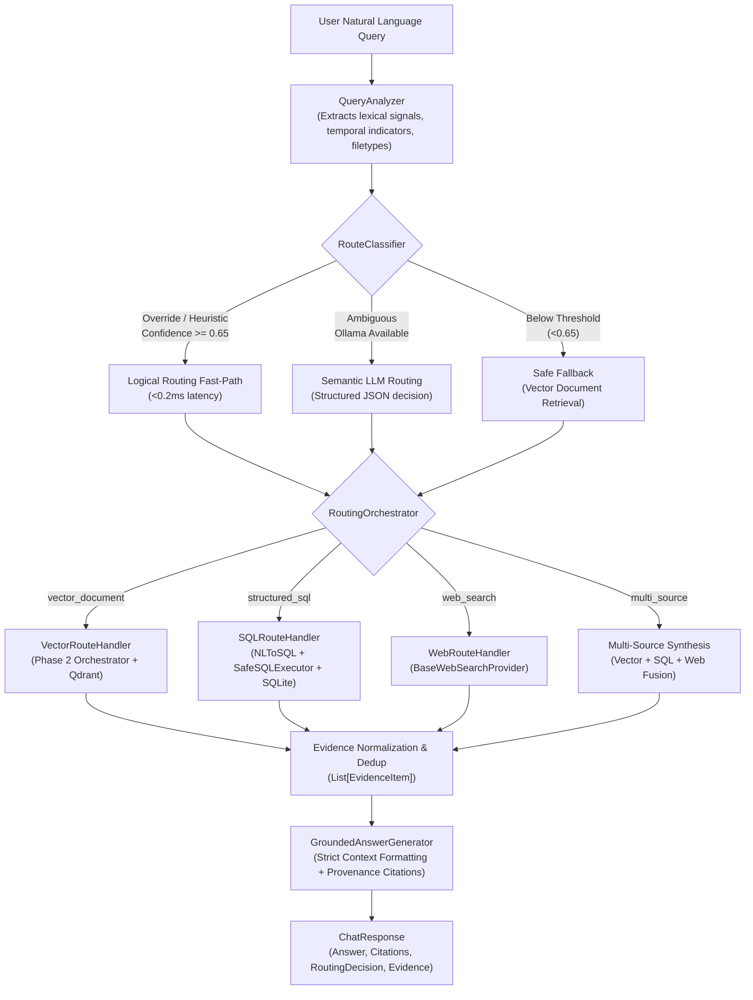

# VeriWeave Phase 3 — Intelligent Multi-Path Query Routing Guide

> **Tagline**: Retrieve intelligently. Reason contextually. Respond reliably.

---

## 1. Overview & Objectives

Phase 3 introduces an **Intelligent Multi-Path Query Routing Engine** that dynamically analyzes user inquiries, identifies the information category required, dispatches execution across heterogeneous knowledge sources, and synthesizes cross-source evidence into verified, grounded responses.

The routing engine classifies queries across four primary pathways:
1. **Vector Document Retrieval (`vector_document`)**: Uses the Phase 2 central retrieval orchestrator (dense similarity, BM25, multi-query, HyDE, decomposition, hybrid fusion, and cross-encoder reranking) for semantic, conceptual, and document-specific questions.
2. **Structured SQL Retrieval (`structured_sql`)**: Translates metadata and database queries into strict, schema-validated, read-only SQL queries against an SQLite catalog backed by SQLAlchemy, preventing hallucinations for exact counts, dates, sizes, and file listings.
3. **External Web Search (`web_search`)**: Queries an extensible web search abstraction (DuckDuckGo provider for live searches, deterministic Mock provider for air-gapped/testing environments) for breaking news, latest software releases, and temporal information.
4. **Multi-Source Synthesis (`multi_source`)**: Decomposes complex compound questions into independent sub-queries, queries multiple sources concurrently/sequentially, deduplicates evidence items, and presents multi-origin citations.

---

## 2. Architecture & Component Design



---

## 3. Structured Database Layer & Security Model

### Schema Architecture
The SQLite catalog maintains structured tables synchronized automatically on document ingestion and deletion:

- **`documents` Table**:
  - `id` (INTEGER, Primary Key)
  - `doc_id` (TEXT, UUID, Indexed)
  - `filename` (TEXT)
  - `file_type` (TEXT: `pdf`, `docx`, `txt`, `md`)
  - `file_size_bytes` (INTEGER)
  - `page_count` (INTEGER)
  - `chunk_count` (INTEGER)
  - `status` (TEXT: `indexed`, `failed`)
  - `created_at` (DATETIME)
  - `updated_at` (DATETIME)

- **`chunks` Table**:
  - `id` (INTEGER, Primary Key)
  - `chunk_id` (TEXT, Indexed)
  - `doc_id` (TEXT, Foreign Key to `documents.doc_id`)
  - `page_number` (INTEGER)
  - `chunk_index` (INTEGER)
  - `token_count_estimate` (INTEGER)
  - `char_start` (INTEGER)
  - `char_end` (INTEGER)

### Defense-in-Depth SQL Security Model
To guarantee that LLM-generated or translated SQL cannot compromise application data:
1. **Read-Only Operation**: Only `SELECT` statements are accepted. Statements starting with any other verb are immediately rejected.
2. **Strict Keyword Blacklist**: Regular expressions reject queries matching `DROP`, `ALTER`, `INSERT`, `UPDATE`, `DELETE`, `TRUNCATE`, `EXEC`, `CREATE`, `ATTACH`, `DETACH`, `PRAGMA`, `REINDEX`, `VACUUM`.
3. **No Semicolons or Chained Queries**: Rejects multiple statements separated by semicolons to prevent stacked SQL injection.
4. **No SQL Comments**: Strips and rejects `--` and `/* ... */` comment tokens to prevent parser circumvention.
5. **Table Allowlist**: Explicit verification ensures tables referenced in `FROM` and `JOIN` clauses belong strictly to `{"documents", "chunks"}`. Access to system tables like `sqlite_master` is rejected.
6. **Execution Row Limit Clamping**: Enforces a strict `LIMIT 50` ceiling on all queries to prevent memory exhaustion.
7. **Timeout Protection**: Transactions execute with timeout guards.

---

## 4. API Reference & Routing Specifications

### Endpoint: `POST /api/v1/chat`

#### Request Parameters
| Field | Type | Default | Description |
| :--- | :--- | :--- | :--- |
| `query` | `string` | *(Required)* | Natural language question (1 - 2000 characters). |
| `routing_mode` | `string` | `"auto"` | Routing mode: `auto`, `document_only`, `sql_only`, `web_only`, `multi_source`. |
| `retrieval_strategy` | `string` | `"baseline"` | Vector retrieval strategy if routed to vector: `baseline`, `multi_query`, `hyde`, `decomposition`, `fusion`, `hybrid`, `hybrid_rerank`, `rerank`. |
| `top_k` | `integer` | `4` | Max candidate chunks to return (1 - 20). |
| `score_threshold` | `float` | `null` | Minimum similarity score filter (0.0 to 1.0). |
| `rerank` | `boolean` | `false` | Apply cross-encoder reranking over vector candidate pool. |
| `filters` | `object` | `null` | Scoped metadata filtering: `{"doc_id": "...", "filename": "...", "page_number": 1}`. |

#### Routing Decision Object in Response (`routing_decision`)
```json
{
  "route": "structured_sql",
  "confidence": 0.95,
  "reasoning": "Query requests structured metadata, document counts, file types, or catalog aggregation.",
  "classification_method": "logical_rule",
  "selected_strategy": "baseline",
  "required_sources": ["structured_sql"],
  "sub_queries": {},
  "fallback_triggered": false
}
```

#### Unified Provenance Citations
Every citation explicitly denotes its source origin:
- **Vector Document**: `doc_id="<uuid>"`, `filename="rag_paper.pdf"`, `page_number=3`, `snippet="..."`
- **Structured Database**: `doc_id="structured_sqlite_db"`, `filename="Database: SQLite Catalog"`, `snippet="[SQL Record] {'total_documents': 4}"`
- **External Web**: `doc_id="external_web_source"`, `filename="Web: LangGraph Overview"`, `snippet="[Web URL: https://...] LangGraph cyclical stategraph..."`

---

## 5. Quantitative Benchmark Results

The routing benchmark evaluated 25 diverse queries across all four target routes (`vector_document`, `structured_sql`, `web_search`, `multi_source`).

### Summary Comparison Table
| Configuration | Accuracy | Macro F1 | Avg Latency (ms) | P95 Latency (ms) | Fallback Rate |
| :--- | :---: | :---: | :---: | :---: | :---: |
| **Pure Logical Heuristics** | **100.0%** | **1.0000** | **0.06 ms** | **0.13 ms** | 4.0% |
| **VeriWeave Adaptive Hybrid** | **100.0%** | **1.0000** | **0.73 ms** | **1.25 ms** | 4.0% |

### Per-Category Performance Breakdown
| Route Category | Support | Precision | Recall | F1-Score |
| :--- | :---: | :---: | :---: | :---: |
| `vector_document` | 7 | 1.0000 | 1.0000 | **1.0000** |
| `structured_sql` | 6 | 1.0000 | 1.0000 | **1.0000** |
| `web_search` | 6 | 1.0000 | 1.0000 | **1.0000** |
| `multi_source` | 6 | 1.0000 | 1.0000 | **1.0000** |

---

## 6. Running Tests & Live Verification

```bash
# Run all automated tests (54 passing tests)
.venv/bin/pytest

# Run routing unit tests specifically
.venv/bin/pytest backend/tests/test_classifier.py backend/tests/test_sql_routing.py backend/tests/test_web_routing.py backend/tests/test_routing_orchestrator.py backend/tests/test_phase3_api.py

# Run the quantitative routing benchmark
.venv/bin/python experiments/benchmark_routing.py

# Run the end-to-end live verification script (5 scenarios)
.venv/bin/python backend/tests/verify_phase3_live.py
```
